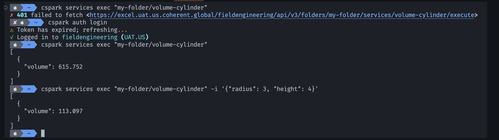

# Coherent Spark CLI

Coherent Spark CLI (currently in **beta**) is a command-line interface that lets
developers interact with the Coherent Spark platform. It is built on top of the
[SDK] and covers a broad subset of platform APIs — authentication, folders,
services, transforms, execution history, import/export, and file downloads.

This CLI is designed for developers who want to interact with the platform in a
more programmatic way, without having to write code.

## Installation

Using [Homebrew](https://brew.sh/):

```bash
brew tap Coherent-Partners/cspark
brew install cspark
```

Using [pip](https://pypi.org/project/cspark/) (`Python 3.8+` required):

```bash
pip install 'cspark[cli]'
```

> We recommend installing the CLI in a virtual or isolated environment when using pip.

## Quick start

```bash
# 1. Create a configuration profile
cspark init

# 2. Authenticate (OAuth2 CCG profiles)
cspark auth login

# 3. Verify connectivity
cspark health check

# 4. Execute a service
cspark services execute "my-folder/my-service" --inputs '{"value": 42}'
```

```bash
$ cspark -v
Coherent Spark CLI 0.1.0-beta (sdk v0.3.2)
```

[](flow.png)

## Command overview

| Group | Purpose |
| ----- | ------- |
| `init` | Create a new configuration profile |
| `config` | Manage configuration profiles |
| `auth` | OAuth2 login / logout / status |
| `health` | Check environment health |
| `folders` | Create, list, update, and delete folders |
| `services` | Create, execute, validate, and manage services |
| `versions` | List service versions |
| `transforms` | Manage api/v4 transforms |
| `logs` | Execution history, downloads, and rehydrate |
| `impex` | Export / import service packages |
| `wasm` | Download WASM / Nodegen packages |
| `files` | Authenticated file download by URL |

Most API commands accept `-H` / `--header` to send extra HTTP headers
(for example `-H "x-request-id: abc"`).

---

## Configuration and authentication

### Profiles

Profiles are stored under `~/.cspark/profiles.yml`. OAuth tokens are cached as
`~/.cspark/{profile}_auth.json`.

```bash
cspark init                          # interactive wizard
cspark init --file ./spark.yml       # from YAML/JSON file
cspark config list -v                # show active profile details
cspark config switch                 # pick another profile
cspark config set timeout=120000     # update a value (key=value)
cspark config get tenant             # read tenant / env / url / auth
cspark config remove                 # delete a profile
```

### Auth

```bash
cspark auth login            # retrieve or reuse a cached token
cspark auth login --refresh  # force token refresh
cspark auth status -v        # show token status
cspark auth logout           # clear cached token
```

---

## Health

```bash
cspark health check   # print health payload (JSON)
cspark health ok      # print true/false; exit 1 when unhealthy
```

---

## Folders

```bash
cspark folders list
cspark folders list --name-only
cspark folders create my-folder --description "Demo folder" --category Other
cspark folders update <FOLDER_ID> --description "Updated"
cspark folders exists my-folder
cspark folders delete my-folder          # interactive confirmation
```

> Category management (`folders.categories`) is available in the SDK but not
> exposed in the CLI.

---

## Services

```bash
# Discover
cspark services list my-folder
cspark services list my-folder --name-only
cspark services search -d '{"page":1,"limit":20}'
cspark services exists my-folder/my-service

# Execute / validate
cspark services execute my-folder/my-service --inputs '{"value": 42}'
cspark services execute my-folder/my-service -i '{"value": 42}' -p call_purpose:demo --show-all
cspark services validate my-folder/my-service --inputs '{"value": 42}' --validation-type dynamic

# Inspect
cspark services schema my-folder/my-service
cspark services metadata my-folder/my-service
cspark services swagger my-folder/my-service -o swagger.json
cspark versions list my-folder/my-service
cspark versions list my-folder/my-service --latest

# Create (upload → compile with progress → publish)
cspark services create my-service \
  --folder my-folder \
  --file ./service.xlsx \
  --versioning minor \
  --label "v1" \
  --release-notes "Initial release"

# Maintain
cspark services recompile my-folder/my-service --version-id <ID> --upgrade patch
cspark services download my-folder/my-service -o service.xlsx
cspark services delete -f my-folder my-service
```

### Create workflow

`services create` orchestrates the full lifecycle:

1. Uploads the Excel workbook
2. Polls compilation progress and shows a spinner (`Compiling... N%`)
3. Publishes the compiled service

`compile` and `publish` are not exposed as standalone CLI commands because they
are subtasks of `create`.

---

## Transforms

Transform definitions are JSON objects with optional fields:
`schema`, `api_version`, `inputs`, `outputs`, and `extras`.

```bash
cspark transforms list my-folder
cspark transforms get my-folder/my-transform
cspark transforms save -f my-folder -n my-transform --file ./transform.json
cspark transforms validate --file ./transform.json
cspark transforms delete my-folder/my-transform
```

Example transform file:

```json
{
  "schema": "JSONtransforms_v1.0.1",
  "api_version": "v3",
  "inputs": "{ \"value\": input.value }",
  "outputs": "{ \"result\": output.result }"
}
```

---

## Logs / history

```bash
cspark logs get <CALL_ID>
cspark logs download -f my-folder -s my-service --type json -o logs.json
cspark logs download -f my-folder -s my-service \
  --start-date 2024-01-01 --end-date 2024-01-31 \
  --call-id abc --call-id def
cspark logs rehydrate my-folder/my-service --call-id <CALL_ID> -o rehydrated.xlsx
```

`logs download` waits for the async download job to complete (with a spinner)
before writing the file.

---

## Import / export (ImpEx)

```bash
# Export a folder or service package
cspark impex export --folder my-folder -o export.zip
cspark impex export --service my-folder/my-service -o service.zip

# Job helpers
cspark impex export describe
cspark impex export status <JOB_ID>
cspark impex export cancel <JOB_ID>

# Import a package
cspark impex import ./export.zip -d my-folder/my-service
cspark impex import ./export.zip -d source/uri=target/uri --if-present add_version

# Job helpers
cspark impex import describe
cspark impex import status <JOB_ID>
```

`impex export` and `impex import` default to the `run` action. You can also call
`impex export run` / `impex import run` explicitly.

---

## WASM and files

```bash
cspark wasm download my-folder/my-service -o service.wasm.zip
cspark wasm download my-folder/my-service --public -o public.zip

cspark files download "https://example.com/path/to/file.zip" -o file.zip
```

---

## Common workflows

### Create and run a service

```bash
cspark folders create pricing --description "Pricing models"
cspark services create quote --folder pricing --file ./quote.xlsx --versioning minor
cspark services schema pricing/quote
cspark services execute pricing/quote --inputs '{"premium": 100}'
```

### Migrate services between environments

```bash
# On source tenant (active profile = source)
cspark impex export --folder pricing -o pricing.zip

# Switch profile to destination tenant
cspark config switch
cspark impex import ./pricing.zip -d pricing/quote --if-present add_version
```

### Investigate an execution

```bash
cspark services execute pricing/quote --inputs '{"premium": 100}' --show-all
# note the call_id from the response, then:
cspark logs get <CALL_ID>
cspark logs rehydrate pricing/quote --call-id <CALL_ID> -o debug.xlsx
```

---

## Tips

- Run `cspark <command> --help` for the full flag list of any command.
- Many groups support short aliases (`ls`, `del`, `exec`, `run`, `find`, `dl`).
- Binary-producing commands accept `-o` / `--output` to write to a file.
- JSON output is the default for API responses so results compose well with
  tools like `jq`.
- Batch pipeline APIs (`client.batches`) are available in the SDK but not yet
  exposed in the CLI.

<!-- References -->
[sdk]: https://pypi.org/project/cspark/
